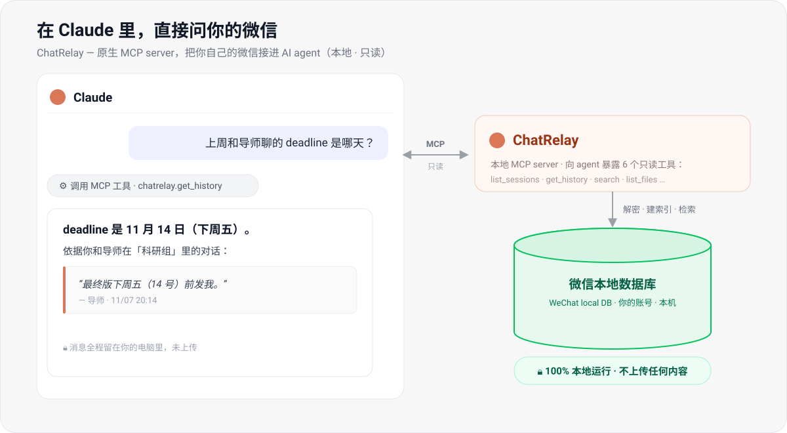

# ChatRelay — 把微信装进你的 AI agent

> A native **MCP server** that plugs **your own** WeChat into Claude / Codex / Cursor — your agent reads and searches your chat history & files, locally, on demand.



**ChatRelay 是一个原生 MCP server,不是又一个"导出工具"。** 它把**你自己的**微信直接接到 AI agent 里:
你在 Claude / Codex / Cursor 里问一句,agent 就通过 MCP **按需、只读**地检索你本机的微信消息、联系人和文件,边问边取——

> 「上周和导师聊的 deadline 是哪天」·「把群里关于报销的消息汇总成表」·「我最近收到哪些 PDF,分别讲了什么」

不用先导出、再手动喂给 AI:**你的微信就是 agent 的一个实时数据源。**

**全程本地运行,不上传任何内容。** 已在 **微信 4.2.0.13 / Windows 11** 上验证通过。

> ### ⚠️ 先读这段
> 本工具**只能、也只应当用于你自己的数据**:它读取的是你本机上**当前登录账号**的微信。
> 请**不要**用它去读、监控、跟踪他人的微信——那可能违反《个人信息保护法》等法律并造成实质伤害。
> 继续使用即代表你已理解并接受下方「风险与边界」。

---

## 为什么是 AI + MCP
同类的微信导出/解密工具很多,但它们大多止步于"把聊天记录导成 ZIP / HTML"。ChatRelay 的重点是**让 AI 直接查**:
- 不用先导出再喂给 AI——AI 通过 MCP **按需检索**你的聊天库,边问边取。
- 聊天记录成为 AI 的**本地知识库**:搜索、跨会话汇总、按联系人/时间追溯。
- 查询走**只读索引,不触发解密**;解密只在你主动 `refresh` 时发生。

## MCP 工具
| 工具 | 作用 |
|---|---|
| `list_sessions(limit)` | 最近会话(名称/是否群/未读/时间) |
| `get_history(conversation, limit, before)` | 读某会话消息(名称或 id,可翻页) |
| `search(keyword, limit, conversation?)` | 搜索聊天记录 |
| `list_contacts(query, limit)` | 查联系人 |
| `list_files(limit)` | 最近收到的文件(含本地路径) |
| `refresh()` | 重新解密并增量更新索引 |

## 运行
```bash
pip install cryptography zstandard "mcp<2"

# 第一次运行前,必须显式确认「使用须知」(确认你读取的是本人数据):
python wxcore/consent.py accept

# 微信需正在运行并已登录;首次会扫描进程内存提取密钥(约 1-2 分钟,之后缓存)
claude mcp add chatrelay -- python <项目路径>/wxcore/mcp_server.py
```
未确认须知时,服务会直接拒绝解密。Claude Desktop 的配置方式、更多细节见 **[wxcore/README.md](wxcore/README.md)**。

## 原理(简述)
1. 从 `Weixin.dll` 提取内部 XOR 密钥;从微信进程内存定位口令;`口令 XOR 密钥 → PBKDF2(256000) → 数据库密钥`。
2. 用该密钥解密本地 WCDB(SQLCipher4)数据库,zstd 解压消息内容。
3. 建成本地索引,通过 MCP 暴露给 AI。

> 这里只给方法的高层描述;本项目**不**提供逐步逆向教程或开箱即用的"一键傻瓜包"——
> 这是有意为之,为的是抬高被滥用于读取他人数据的门槛。要跑通它,你需要能读懂并自行配置这些代码。

## ⚠️ 风险与边界
- **仅限处理你本人拥有、或你本人在自有设备上有权访问的数据。** 不要用于读取、监控、跟踪他人的微信,不要部署到他人设备或远程静默运行。本工具只认"本机正在登录的账号",它**无法**分辨操作者是不是账号本人——这把门槛在**你**手里。
- **解密依赖读取微信进程内存,属于逆向工程手段**,很可能**违反微信的服务条款**,并可能触发账号风控、限制或封禁。同类项目曾收到微信官方函件或 DMCA 下架。使用风险由你自行承担。
- 本项目**只读**:不发送消息、不修改微信、不联网(除你自己配置的 AI 服务外)。
- 解密副本与索引是明文,保存在 `%LOCALAPPDATA%\ChatRelay\`;不需要时删除该目录即可。
- 本项目仅用于个人数据归档与安全研究,不构成法律意见。遵守当地法律与微信服务条款是你的责任。

## 致谢 / Attribution
微信 4.x 的密钥提取方法(DLL 内 XOR 密钥的汇编特征、内存中密钥描述结构、口令 + PBKDF2 的派生流程)参考并移植自以下开源项目的研究成果,特此致谢:
- [LifeArchiveProject/WeChatDataAnalysis](https://github.com/LifeArchiveProject/WeChatDataAnalysis)(`key_v4.py` / `dll_key_scan.py`)
- [zhuobichen/weflow-cli](https://github.com/zhuobichen/weflow-cli)、[vpcoderli/wxq](https://github.com/vpcoderli/wxq)

上游研究项目各有其许可与权利。**若任何上游作者认为本项目的移植不妥,请提 issue 告知,我会配合下架或整改。**

## 许可
见 [LICENSE](LICENSE)(MIT)。注意:上游研究项目有各自的许可与权利,移植部分的权利归原作者所有。
